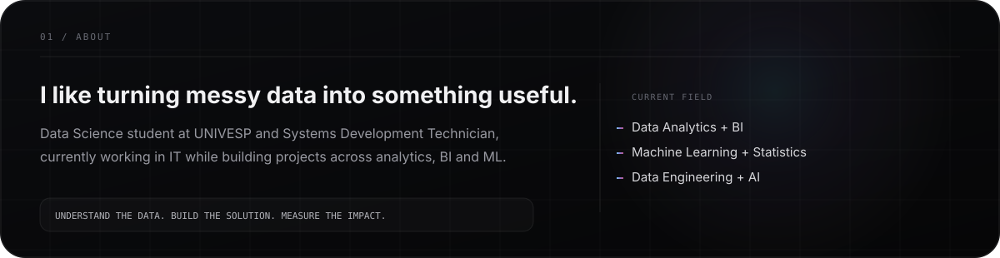
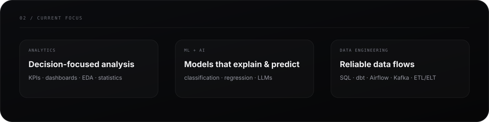

 

  

  

  

## `03 / TOOLBOX`

### Languages

  

### Data + Analytics

  
  &nbsp;&nbsp;
  
  &nbsp;&nbsp;
  
  &nbsp;&nbsp;
  
  &nbsp;&nbsp;
  
  &nbsp;&nbsp;
  
  &nbsp;&nbsp;
  
  &nbsp;&nbsp;
  

Python • PostgreSQL • Pandas • NumPy • dbt • Kafka • Airflow • Power BI • SQL • Statistics • EDA

  

### AI + Machine Learning

  
  &nbsp;&nbsp;&nbsp;
  
  &nbsp;&nbsp;&nbsp;
  
  &nbsp;&nbsp;&nbsp;
  
  &nbsp;&nbsp;&nbsp;
  

Scikit-learn • TensorFlow • PyTorch • Machine Learning • Deep Learning • AI • LLMs

  

### Business Intelligence

  
  &nbsp;&nbsp;&nbsp;
  

  

### Backend + Systems

 

  

## `04 / SELECTED WORK`

### 💳 Financial Transaction Anomaly Detection
Machine Learning project focused on identifying suspicious financial transactions using **Logistic Regression, SMOTE and StandardScaler**, evaluated with **precision, recall, F1-score and confusion matrix**.

[**view repository →**](https://github.com/claudiogardenaldev/Deteccao-de-Anomalias-em-Python)

 

### 🛒 Olist E-commerce Analytics
Relational data analysis with **SQL**, joins, aggregations and views to explore **revenue, average order value, freight, geographic sales and delivery delays**.

 

### 📊 Superstore Business Intelligence
Power BI project using **Power Query and DAX** to analyze **revenue, profit, margin, discounts, sales volume and logistics performance**.

  

## `05 / GITHUB`

  

