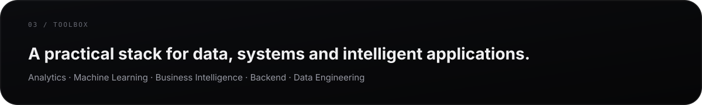
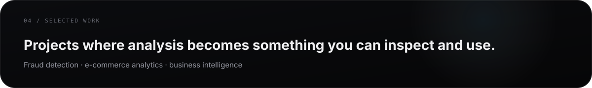

 

  

  

  

  

### Languages

  

### Data + Analytics

 

  

### AI + Machine Learning

 

  

### Business Intelligence

  

### Backend + Systems

 

  

  

### 💳 Financial Transaction Anomaly Detection

Machine Learning project focused on identifying suspicious financial transactions using **Logistic Regression, SMOTE and StandardScaler**, evaluated with **precision, recall, F1-score and confusion matrix**.

[**view repository →**](https://github.com/claudiogardenaldev/Deteccao-de-Anomalias-em-Python)

 

### 🛒 Olist E-commerce Analytics

Relational data analysis with **SQL**, joins, aggregations and views to explore **revenue, average order value, freight, geographic sales and delivery delays**.

 

### 📊 Superstore Business Intelligence

Power BI project using **Power Query and DAX** to analyze **revenue, profit, margin, discounts, sales volume and logistics performance**.

  

## `05 / GITHUB`

  

